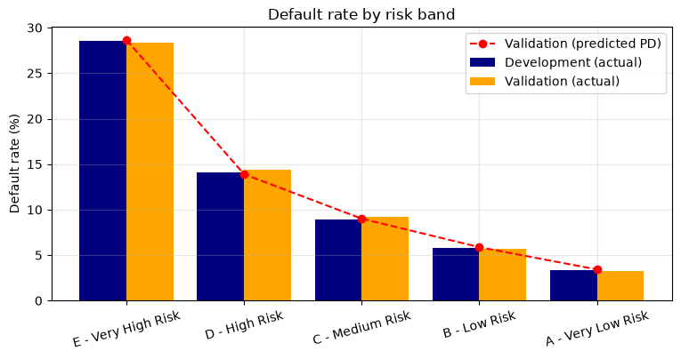
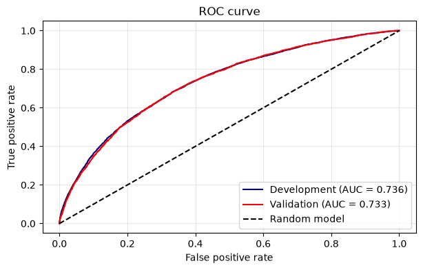
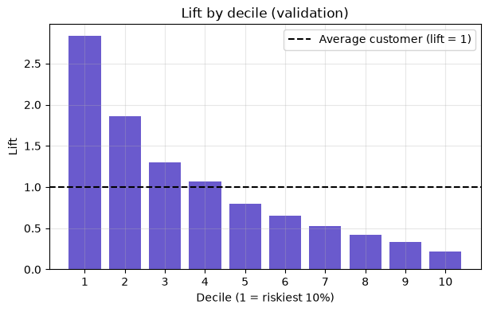

# Probability of Default (PD) Scorecard — Unsecured Personal Loans

An end-to-end **credit application scorecard** built in Python. Every loan applicant gets a **credit score (600-point scale)** and a **probability of default (PD)**, using the standard banking pipeline: Weight of Evidence (WoE) binning → Information Value (IV) → multi-step variable selection (correlation, VIF, backward elimination) → logistic regression (statsmodels) → points scaling → out-of-time validation.

> **Note:** All data is **synthetic** (no real customer data). The default mechanism is known, so the performance numbers are more optimistic than real bank data would give.

---

## Results at a glance

| Metric | Development | Validation (out-of-time) |
|---|---|---|
| AUC | 0.7356 | 0.7335 |
| Gini | 0.4712 | 0.4670 |
| KS | 0.3492 | 0.3501 |
| Avg predicted PD vs actual default rate | 11.94% vs 11.94% | 11.96% vs 11.98% |
| Score PSI (dev vs validation) | — | 0.0001 (stable) |
| CSI (all 9 model variables) | — | below 0.001 (stable) |

- Discrimination is almost unchanged from development to validation (AUC 0.7356 vs 0.7335, KS slightly higher on validation), so there is no sign of overfitting.
- Predicted PD matches the actual default rate on average and across risk bands.
- Default rate falls steadily from the riskiest to the safest band. The riskiest band defaults about **8.6x more often** than the safest:

| Risk band | Actual default rate (validation) |
|---|---|
| E – Very High Risk | 28.4% |
| D – High Risk | 14.4% |
| C – Medium Risk | 9.2% |
| B – Low Risk | 5.7% |
| A – Very Low Risk | 3.3% |

- **Lift:** the riskiest 10% of customers default at **2.83x** the average rate and contain 28.3% of all defaults. The riskiest 30% contain **59.9%** of all defaults.





---

## Project workflow

| Step | What I did |
|---|---|
| 1. Data | Simulated 75,000 loans (INR) with a hidden risk factor so utilisation, enquiries and missed payments move together. Intercept calibrated to a ~12% default rate (actual: 11.95%) |
| 2. Messiness | Added missing values, 15 duplicate rows and inconsistent labels to practise cleaning |
| 3. Quality checks & EDA | Missing values, duplicates, logic checks, default-rate trend by month, default rate by variable bucket, correlation matrix |
| 4. Out-of-time split | Development: applications before Apr 2024 (46,908 rows). Validation: Apr 2024 onwards (28,092 rows) |
| 5. Cleaning | Median/mode fill and 1st–99th percentile capping, **fitted on development only** and applied to validation (no leakage) |
| 6. WoE & IV | Quintile binning for numeric variables, raw values for text or few-value variables; WoE and IV for all 27 candidates |
| 7. Variable selection | IV filter → correlation pruning → VIF check → backward elimination (see below) |
| 8. Model | Logistic regression in **statsmodels** on WoE values (coefficients, standard errors, p-values) |
| 9. Scorecard | Coefficients converted to points; customers grouped into 5 risk bands |
| 10. Validation | AUC, Gini, KS, calibration, lift by decile, PSI (score) and CSI (each variable) |

### Variable selection (27 candidates → 9 variables)

| Step | Rule | Result |
|---|---|---|
| IV filter | Keep IV between 0.02 and 0.5 | 12 variables left |
| Correlation pruning | Drop the lower-IV variable of any pair with correlation above 0.7 | `term_months` dropped, 11 left |
| VIF check | Remove the highest-VIF variable while any VIF is above 5 | Highest VIF was 3.54, nothing removed |
| Backward elimination | Remove one variable at a time for a wrong-sign coefficient, then for p-value above 0.05 | `existing_emi` dropped (wrong sign), then `emi` dropped (p-value = 0.71), 9 left, all p-values below 0.001 |

### Final model (9 variables)
`credit_utilisation`, `emi_to_income`, `enquiries_12m`, `dpd30_12m`, `debt_to_income`, `dpd90_12m`, `interest_rate`, `income_verified`, `prior_default`

- Strongest variable by IV: **credit utilisation (IV = 0.252)**. Customers in the highest-utilisation quintile default at 22.0%, against 6.4% in the lowest.
- All coefficients are negative, which is the expected direction because WoE is higher for safer customers.

### Score scaling
- Base score = **600** at good:bad odds of **50:1**
- **PDO = 20** (every 20 points doubles the odds of being good)
- Factor = PDO / ln(2) = 28.854, Offset = 487.123
- Higher score = safer customer. Score range on development data: 428 to 607

---

## Repository contents

| File | Description |
|---|---|
| `PD_Scorecard_Final.ipynb` | Full analysis, code and outputs |
| `outputs/scorecard_points.csv` | Final scorecard: points for every bin of every variable |
| `outputs/iv_ranking.csv` | IV of all candidate variables |
| `images/` | Charts used in this README |

---

## How to run

```bash
git clone https://github.com/<your-username>/pd-scorecard-unsecured-loans.git
cd pd-scorecard-unsecured-loans
pip install -r requirements.txt
jupyter notebook PD_Scorecard_Final.ipynb
```
Run all cells from top to bottom. A fixed random seed (100) gives the same data and results every time.

**Tools:** Python, pandas, NumPy, statsmodels, scikit-learn, Matplotlib

---

## Limitations and next steps

**Limitations**
- Synthetic data, so discrimination is optimistic and real data would be noisier
- Simple quintile binning (no monotonic merging of bins)
- One out-of-time window, no reject inference, and no fairness or regulatory review of the chosen variables

**Possible improvements**
- Coarse-classing with monotonic bins
- Test how sensitive the risk-band cut-offs are
- Compare against a gradient boosting model
